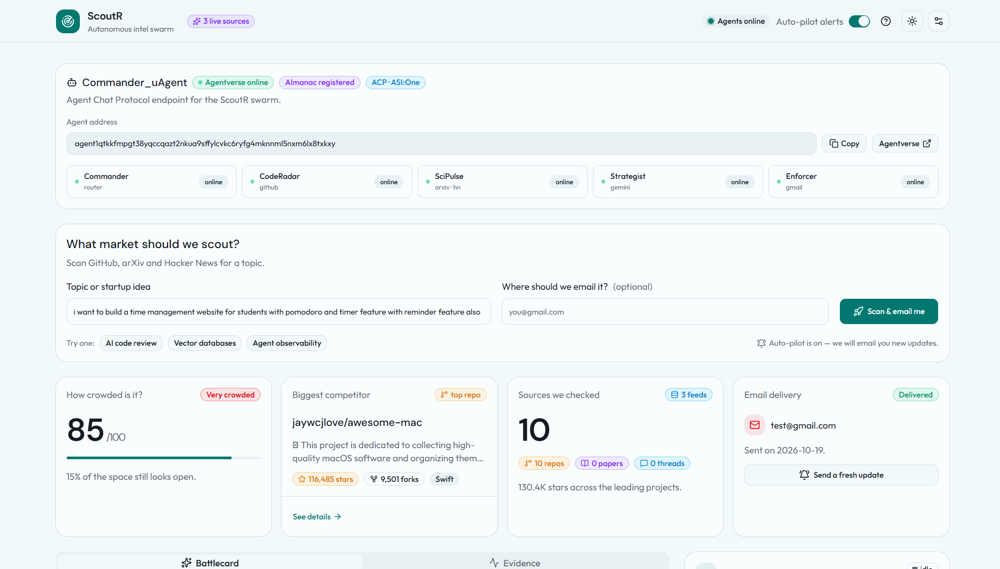

# ScoutR

ScoutR is a competitive-intelligence dashboard and an Agentverse uAgent. Give it a
topic, and it fetches live signals from **GitHub**, **arXiv** and **Hacker News**, asks
**Gemini 2.5 Flash** for an analysis, and returns a battlecard:

- a threat score from `0` (wide open) to `100` (saturated)
- what **not** to build, with named incumbents
- the most defensible opening
- the newest signal worth acting on
- an optional HTML battlecard by email

**Live app:** [https://scoutr-nine.vercel.app](https://scoutr-nine.vercel.app)  
**Repository:** [github.com/Prakash1185/Fetch-a-thon-r1](https://github.com/Prakash1185/Fetch-a-thon-r1)  
**Agentverse agent:** [Commander_uAgent](https://agentverse.ai/agents/details/agent1qtkkfmpgt38yqccqazt2nkua9sffylcvkc6ryfg4mknnml5nxm6lx8txkxy)


<p align="center">
  
</p>


---

## What is actually an agent?

There is **one registered uAgent**: `Commander_uAgent` in
[`agentverse/agent.py`](./agentverse/agent.py). It speaks the Agent Chat Protocol (ACP)
and forwards chat intents to the Next.js API.

The four other names in the dashboard are **tool workers inside the Next.js pipeline**,
not separately registered agents:

| Name | Real role | Runs in |
| --- | --- | --- |
| Commander | ACP chat front door, intent parsing, reply formatting | Agentverse (`agent.py`) |
| CodeRadar | GitHub repository search | `lib/scout/sources.ts` |
| SciPulse | arXiv Atom + Hacker News Algolia | `lib/scout/sources.ts` |
| Strategist | Gemini 2.5 Flash JSON analysis | `lib/scout/analysis.ts` |
| Enforcer | Gmail SMTP delivery | `lib/scout/email.ts` |

This distinction is intentional. The UI labels Commander as `uAgent` and the rest as
`worker`.

---

## Architecture

```text
Dashboard (browser)                    Agentverse / ASI:One chat
        |                                        |
        | POST /api/scout                        v
        |                              Commander_uAgent (ACP)
        |                                        |
        |                                        | POST /api/scout
        v                                        v
                 Next.js route: app/api/scout/route.ts
                                |
          +---------------------+---------------------+
          |                     |                     |
     CodeRadar              SciPulse              Strategist
   GitHub REST          arXiv + HN Algolia     Gemini 2.5 Flash
          |                     |                     |
          +---------------------+---------------------+
                                |
                             Enforcer
                         Gmail SMTP (optional)
                                |
                                v
             JSON battlecard + trace + optional HTML email
```

The dashboard calls `/api/scout` directly. It does not route through Agentverse. When you
chat with Commander, Commander calls the same public endpoint.

---

## Quick start

Requirements: Node.js 20+ and npm.

```bash
npm install
copy .env.example .env.local   # Windows
# cp .env.example .env.local   # macOS / Linux
npm run dev
```

Open [http://localhost:3000](http://localhost:3000). Enter a topic and click **Scan
market**, or add an email and click **Scan & email me**.

### Environment variables

| Key | Required | Purpose |
| --- | --- | --- |
| `GEMINI_API_KEY` | Yes for Gemini | Gemini API key from Google AI Studio |
| `GEMINI_MODEL` | No | Defaults to `gemini-2.5-flash` |
| `GITHUB_TOKEN` | No | Raises GitHub search limits (10 → 30 requests/min) |
| `GMAIL_USER` | For email | Gmail address used as the sender |
| `GMAIL_APP_PASSWORD` | For email | Gmail App Password, not the account password |

`.env*` is gitignored. Never commit real keys.

If `GEMINI_API_KEY` is missing or Gemini fails, the API returns a deterministic local
analysis and reports `ai.engine: "heuristic"`. If Gmail is not configured, the scan still
succeeds and reports `email.sent: false`.

---

## API

### `POST /api/scout`

```json
{
  "topic": "vector databases",
  "alertEmail": "you@example.com",
  "mode": "recon"
}
```

- `topic` — required, 2–200 characters.
- `alertEmail` — optional. When present, ScoutR sends the HTML battlecard.
- `mode` — `rapid`, `recon` or `deep-dive`. Defaults to `recon`.

The mode is passed to the Gemini prompt. It does **not** change how many repos, papers or
threads are fetched.

A successful response includes:

```text
success, topic, mode, generatedAt
items.repositories[], items.papers[], items.discussions[]
analysis.threatScore, analysis.sentiment, analysis.killZone,
analysis.whiteSpaceMoat, analysis.deltaAlert
ai.model, ai.engine, ai.latencyMs, ai.note?
email.requested, email.sent, email.to, email.error?
sources.github, sources.arxiv, sources.hackernews
stats.totalSignals, stats.combinedStars, stats.avgPoints, stats.freshestSignalDays
trace[]  // real step timings returned with the response
```

Errors return `{ success: false, error, detail, trace? }` with `400`, `422`, `502`, etc.
`GET /api/scout` returns `405` with usage details.

### Example

```bash
curl -X POST https://scoutr-nine.vercel.app/api/scout \
  -H "Content-Type: application/json" \
  -d "{\"topic\":\"vector databases\",\"mode\":\"recon\"}"
```

---

## Verify it end-to-end

Start the dev server, then in another terminal:

```bash
npm run verify
```

Or target the live deployment:

```bash
node scripts/verify-scout.mjs --url https://scoutr-nine.vercel.app
```

The verifier checks the `405` / `400` / `422` guards, then runs a real scan and validates
the battlecard shape, live signals, source telemetry and trace. Add
`--email you@example.com` to send a real email. Add `--topic` or `--mode` to change the
scan.

`npm run verify` is an alias for `node scripts/verify-scout.mjs`.

---

## Agentverse setup

The full steps are in [`agentverse/README.md`](./agentverse/README.md). Short version:

1. Open the hosted agent in Agentverse → **Build**.
2. Paste [`agentverse/agent.py`](./agentverse/agent.py).
3. Add the secret `SCOUT_API_URL=https://scoutr-nine.vercel.app`. Optionally add
   `SCOUT_DEFAULT_EMAIL` and `SCOUT_MODE`.
4. Click **Stop**, then **Run** so the new code and secrets load.
5. Open **Chat with Agent** and send:

```text
scout vector databases
autonomous browser agents mode:deep-dive
AI code review and email me at you@example.com
```

Expected reply: threat score, sentiment, “Don't build”, “Your opening”, “What changed”,
top repos, and email status. Expected Agentverse logs:

```text
ScoutR Commander online | address=agent1qtkk...
ACP ready | scout endpoint=https://scoutr-nine.vercel.app/api/scout
dispatching scout | topic=vector databases | mode=recon | email=off | endpoint=...
scout complete | topic=vector databases | signals=... | engine=gemini | email=off
```

Hosted agents cannot reach `localhost`. `SCOUT_API_URL` may be the app root or the full
`/api/scout` URL; both work.

**Agent address**

```text
agent1qtkkfmpgt38yqccqazt2nkua9sffylcvkc6ryfg4mknnml5nxm6lx8txkxy
```

ASI:One discovery depends on Agentverse indexing the agent profile. The agent works
through Agentverse chat as soon as it is running and registered.

---

## Deploy to Vercel

1. Import the repository into Vercel.
2. Add `GEMINI_API_KEY` (and optionally `GEMINI_MODEL`, `GITHUB_TOKEN`, `GMAIL_USER`,
   `GMAIL_APP_PASSWORD`) under **Settings → Environment Variables**.
3. Deploy.
4. Set `SCOUT_API_URL` in Agentverse to the deployment URL.
5. Run the verifier against the deployment.

The route sets `maxDuration = 60` because scans include several network calls and one
Gemini request. `next.config.ts` enables `cacheComponents`; route-segment `runtime` and
`dynamic` exports are therefore not used.

---

## Project structure

```text
app/
  page.tsx                 dashboard, trace console, dialogs
  layout.tsx               metadata, fonts, theme and toaster
  api/scout/route.ts       validation, pipeline orchestration, response
components/                shadcn UI primitives and theme toggle
lib/scout/
  sources.ts               GitHub, arXiv and Hacker News fetchers
  analysis.ts              Gemini prompt, schema and heuristic fallback
  email.ts                 Nodemailer HTML battlecard
  types.ts                 shared API contracts
  format.ts                display helpers
agentverse/
  agent.py                 Commander_uAgent (ACP)
  README.md                Agentverse deployment and test notes
  requirements.txt         Python dependencies
  .env.example             local agent environment
scripts/
  verify-scout.mjs         end-to-end API verifier
```

---

## What is honest about this build

- **One uAgent, four workers.** Only Commander is registered on Agentverse.
- **No background scheduler.** There is no auto-pilot, cron or “re-check every 15
  minutes” feature. Every scan is triggered by a request.
- **No real-time log stream.** The trace console shows the real `trace` array returned by
  `/api/scout` after the request finishes. It does not stream Agentverse logs.
- **No fake progress lines.** While a scan is running, the console shows only the request
  state. Worker steps appear when the API responds.
- **Modes are prompt hints.** `rapid`, `recon` and `deep-dive` change the instruction sent
  to Gemini; they do not change source limits.
- **GitHub results are filtered.** Curated “awesome” lists are excluded, and a repository
  must contain the main topic terms close together in its name, description or topics.
  Fewer relevant repos are better than a fake competitor.
- **Scores are directional.** The threat score is generated from the fetched signals, not
  from paid market data. It is not investment advice.
- **Email is Gmail-only.** Delivery requires a Gmail account and App Password.
- **The API is public.** There is no authentication or rate limiting in this hackathon
  build. Add both before exposing it beyond a demo.

---

## Troubleshooting

| Symptom | Check |
| --- | --- |
| `Topic is required` | Send at least 2 characters in `topic`. |
| `Invalid alert email` | Remove `alertEmail` or send a valid address. |
| `No live signals found` | Try a broader topic; all three sources returned nothing usable. |
| `ai.engine` is `heuristic` | `GEMINI_API_KEY` is missing, invalid, or Gemini failed. The `ai.note` field has the reason. |
| Email says not configured | Set `GMAIL_USER` and `GMAIL_APP_PASSWORD` in the deployment. |
| Hosted agent cannot reach the API | `SCOUT_API_URL` is still `localhost` or the deployment is down. |
| GitHub returns `403` / rate limit | Add `GITHUB_TOKEN` or wait for the unauthenticated limit to reset. |
| Agentverse keyword not found | Indexing can lag. Open the agent page directly and use **Chat with Agent**. |

---

## Stack

Next.js 16 App Router, React 19, TypeScript, Tailwind CSS v4, shadcn UI, Gemini 2.5 Flash,
Nodemailer, and `uagents` with the Agent Chat Protocol.
